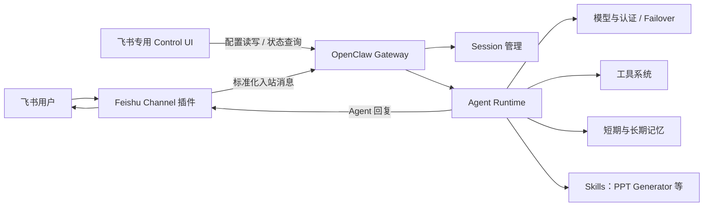

# OpenClaw Feishu Agent

基于 [OpenClaw](https://github.com/openclaw/openclaw) 二次开发的飞书专用 AI Agent 客户端。项目复用 OpenClaw 的 Gateway、Agent Runtime、会话、工具、记忆与插件体系，重点优化飞书接入体验，并增加面向演示场景的 PPT HTML 生成 Skill。

> 本仓库是个人二次开发与 AI 产品作品集项目，不是 OpenClaw 官方发行版。OpenClaw 原项目及商标归其各自权利人所有。

## 项目目标

OpenClaw 原生支持大量消息渠道，但对于只需要部署飞书机器人的使用者，完整的 Channel 列表和多层配置入口会增加理解与操作成本。本项目聚焦一条更短的核心链路：

1. 管理员在 Control UI 中直接填写飞书凭据；
2. Gateway 保存配置并启动 Feishu Channel；
3. 用户在飞书私聊或群聊中向 Agent 发起任务；
4. Agent 复用 OpenClaw 的模型、工具、记忆与会话能力处理请求；
5. 飞书插件将回复送回原会话，并按平台能力完成格式适配。

## 二次开发内容

### 1. 飞书专用 Channel UI

- Channel 页面只展示 Feishu，隐藏其他渠道的添加入口与配对筛选项；
- 保留 OpenClaw Gateway 与插件系统，后端并未删除其他 Channel 的实现；
- 将 `App ID`、`App Secret` 等关键字段直接放到页面主区域，不再要求用户进入多层详情或重复启动配置向导；
- 明确区分必填项与有默认值的选填项；
- 默认使用 Feishu 区域和 WebSocket 长连接，适合本地部署且无需公网回调地址；
- Webhook 模式下按需展示 `Verification Token`、`Encrypt Key` 和回调路径；
- 保存过程提供“保存中 / 保存成功 / 保存失败 / 配置冲突”状态，避免点击后没有反馈；
- Secret 保存后以“已保存”的掩码状态回显。页面不会重新展示明文，但留空不会删除原值，输入新值才会替换；
- 避免配置向导重复启动导致 `OpenClaw setup is already in progress` 冲突。

### 2. 飞书 Channel 与 Agent 能力复用

- 使用官方 Feishu 插件的 Channel 注册、账号解析、消息收发和生命周期接口；
- 复用 Gateway 的标准配置读写、状态查询与错误反馈机制；
- 复用基于 `sessionKey` 的私聊、群聊与线程会话隔离；
- 复用 Agent Runtime 的模型路由、OAuth、Failover、Rate Limit、工具与记忆能力；
- 保持 Channel 只负责传输与平台适配，Agent 能力通过插件 SDK 和 Skills 扩展。

### 3. PPT Generator Skill

在 `extensions/feishu/skills/ppt-generator/` 中内置并启用由 [@wwlyzzyorg/ppt-generator](https://clawhub.ai/wwlyzzyorg/skills/ppt-generator) 改造的 Skill：

- 用户明确要求制作演示文稿、幻灯片或 PPT 风格页面时触发；
- 将演讲稿压缩为结构化大纲，再生成极简科技风的 9:16 HTML 演示稿；
- 保留用户原始语言，不虚构事实、数据或效果；
- 增加内容安全、HTML 转义、无障碍和第三方 CDN 风险提示；
- 通过 Feishu 插件 manifest 的 `skills` 目录自动发现，无需把能力硬编码进 Channel。

当前版本生成的是单文件 HTML 演示稿，不是原生 `.pptx`。模板会加载第三方 CDN 资源，因此不适合直接处理未脱敏的机密材料或完全离线场景。

## 系统架构



核心边界如下：

| 层级    | 本项目的处理方式                                        |
| ------- | ------------------------------------------------------- |
| 客户端  | 修改 `ui/`，提供飞书专用配置和状态反馈                  |
| Gateway | 复用 OpenClaw 的 WebSocket/HTTP API、配置、会话与运行时 |
| Channel | 复用 `extensions/feishu/` 的飞书消息适配与生命周期      |
| Agent   | 复用 OpenClaw Agent Runtime、模型、工具和记忆系统       |
| Skill   | 在 Feishu 插件的 `skills` 目录中添加 PPT Generator      |

## 环境要求

- macOS、Linux 或 Windows；
- Node.js `22.22.3+ <23`、`24.15.0+ <25` 或 `25.9.0+`，推荐 `24.15.0+`；
- pnpm `11.15.1`；
- 一个可用的模型提供商账号或本地模型配置；
- 一个已创建的飞书企业自建应用。

本项目使用 pnpm workspace，请勿使用 npm 或 yarn 重新生成锁文件。

## 本地启动

### 1. 安装依赖

```bash
pnpm install
```

### 2. 初始化 OpenClaw

完整交互式初始化：

```bash
pnpm openclaw onboard
```

如果暂时不配置模型认证，可先创建最小工作区：

```bash
pnpm openclaw setup --baseline
```

### 3. 启动 Gateway

```bash
pnpm gateway:watch
```

没有 tmux 或需要持续查看前台日志时：

```bash
pnpm gateway:watch:raw
```

Gateway 默认监听 `127.0.0.1:18789`。同一地址和端口只能运行一个实例。

### 4. 启动 Control UI

另开一个终端：

```bash
pnpm ui:dev --host 127.0.0.1
```

打开 `http://127.0.0.1:5173`。Gateway 构建后的 Control UI 地址为 `http://127.0.0.1:18789`。

### 5. 验证 Gateway

```bash
pnpm openclaw health
```

## 飞书接入

### 1. 创建并配置飞书应用

在[飞书开放平台](https://open.feishu.cn/app)创建企业自建应用，启用机器人能力，并在“凭证与基础信息”中获取：

- `App ID`：必填，通常以 `cli_` 开头；
- `App Secret`：必填，属于敏感凭据，不要提交到 Git 或粘贴到公开日志。

随后为应用配置消息所需权限，并订阅 `im.message.receive_v1` 事件。应用需要发布并通过企业管理员审核，机器人才能稳定接收消息。完整权限、事件和群聊策略请参考 [`docs/channels/feishu.md`](docs/channels/feishu.md)。

### 2. 在 Control UI 中保存配置

进入“频道”页面后直接填写表单：

| 配置项             | 是否必填     | 默认值 / 说明                        |
| ------------------ | ------------ | ------------------------------------ |
| App ID             | 是           | 飞书应用标识                         |
| App Secret         | 是           | 保存后仅显示已保存状态，不回显明文   |
| 服务区域           | 否           | 默认 `Feishu`；国际版应用选择 `Lark` |
| 连接方式           | 否           | 默认 `WebSocket`                     |
| Verification Token | Webhook 必填 | 从事件订阅配置复制                   |
| Encrypt Key        | Webhook 必填 | 从事件订阅配置复制                   |
| Webhook Path       | 否           | 默认 `/feishu/events`                |

点击“保存飞书配置”后，等待页面显示保存成功。若出现冲突提示，先重新加载最新配置，再重新填写并保存。

### 3. 配置事件接收

推荐选择 WebSocket 长连接：

- 不需要公网回调地址；
- 更适合本地开发和个人部署；
- 飞书开放平台的事件订阅方式也需要设置为长连接。

只有在已有稳定公网 HTTPS 入口时才建议使用 Webhook，并同时配置验证令牌、加密密钥和回调路径。

### 4. 验证消息链路

1. 将机器人加入测试群，或直接向机器人发送私聊；
2. 群聊默认需要 `@机器人`；
3. 查看 Gateway 日志确认事件已进入；
4. 如私聊启用了默认 pairing 策略，在 UI 中审批请求，或使用：

```bash
pnpm openclaw pairing list feishu
pnpm openclaw pairing approve feishu <CODE>
```

## 使用 PPT Generator

Skill 会随 Feishu 插件的 `skills` 目录自动加载。可以在飞书中发送类似请求：

> 请把下面的演讲稿整理成 12 页、9:16、极简科技风的 PPT HTML，并保留中文表达。

建议同时提供：目标受众、演讲时长、页数、视觉风格和完整原稿。生成结果是 HTML 文件；如需要原生 PowerPoint 文件，应改用支持 `.pptx` 的演示文稿工具。

如果在 Gateway 运行期间新增或修改 Skill，请重启 Gateway，让进程重新发现插件的稳定元数据。

## 架构分析文档

| 文档                                                                                                             | 内容                                                |
| ---------------------------------------------------------------------------------------------------------------- | --------------------------------------------------- |
| [`docs_sh/系统架构说明.md`](docs_sh/系统架构说明.md)                                                             | 全局目录、启动链路、模块依赖与端到端消息流          |
| [`docs_sh/phase1_client_gateway_integration_analysis.md`](docs_sh/phase1_client_gateway_integration_analysis.md) | Web、原生客户端与 Gateway 的共同接入机制和差异      |
| [`docs_sh/phase2_gateway_standard_client_integration.md`](docs_sh/phase2_gateway_standard_client_integration.md) | Gateway 标准客户端接入方式与输入输出协议            |
| [`docs_sh/phase3_custom_channel_plugin_contract.md`](docs_sh/phase3_custom_channel_plugin_contract.md)           | 自定义 Channel 插件的配置、入站、出站与生命周期规范 |
| [`docs_sh/phase4_agent_runtime_architecture.md`](docs_sh/phase4_agent_runtime_architecture.md)                   | Agent Runtime、模型、工具、记忆与会话架构           |
| [`docs_sh/前四节建议补充.md`](docs_sh/前四节建议补充.md)                                                         | 插件微内核、配置状态、安全、自动化与 Node 架构补充  |

## 验证与开发命令

```bash
# 构建 Gateway 使用的 Control UI
pnpm ui:build

# 校验 Control UI 英文源文案与多语言运行时接线
pnpm ui:i18n:verify

# 运行 Channel 页面相关的聚焦测试
node scripts/run-vitest.mjs \
  ui/src/pages/channels/view.test.ts \
  ui/src/pages/channels/view.pairing.test.ts \
  ui/src/pages/channels/wizard-controller.test.ts

# 查看 PPT Skill 是否已被发现并启用
pnpm openclaw skills info ppt-generator --json
```

## 已知限制与后续方向

- 当前只收敛了 Channel 管理 UI，OpenClaw 核心和插件目录仍包含其他渠道；
- 当前表单优先覆盖单账号接入，多账号管理仍沿用 OpenClaw 的完整配置能力；
- Secret 为安全起见不会明文回显，只显示“已保存”状态；
- PPT Generator 当前输出 HTML，并依赖第三方 CDN；
- 项目仍需补充真实飞书消息回环、弱网重连、权限不足和 Webhook 部署的系统化验收证据；
- 后续可继续拆分 Phase 5–9：插件微内核、配置与状态、安全、自动化任务、Node 与分布式执行。

## 安全说明

- 不要提交 `App Secret`、模型 API Key、OAuth token、配对码或运行时配置；
- 不要把未脱敏的内部材料交给使用第三方 CDN 的演示模板；
- 对外开放 Gateway 前，应先配置认证、访问控制、网络边界和工具执行沙箱；
- 私聊默认采用 pairing 策略，群聊应根据实际人员范围配置 allowlist 与 `requireMention`。

## 上游与许可证

本项目基于 [openclaw/openclaw](https://github.com/openclaw/openclaw) 开发，核心代码继续遵循根目录 [`LICENSE`](LICENSE) 中的 MIT License。

PPT Generator 的上游来源、版本和改造说明记录在 [`extensions/feishu/skills/ppt-generator/ORIGIN.md`](extensions/feishu/skills/ppt-generator/ORIGIN.md)，其代码按 [`extensions/feishu/skills/ppt-generator/LICENSE`](extensions/feishu/skills/ppt-generator/LICENSE) 中的 MIT-0 License 使用。
