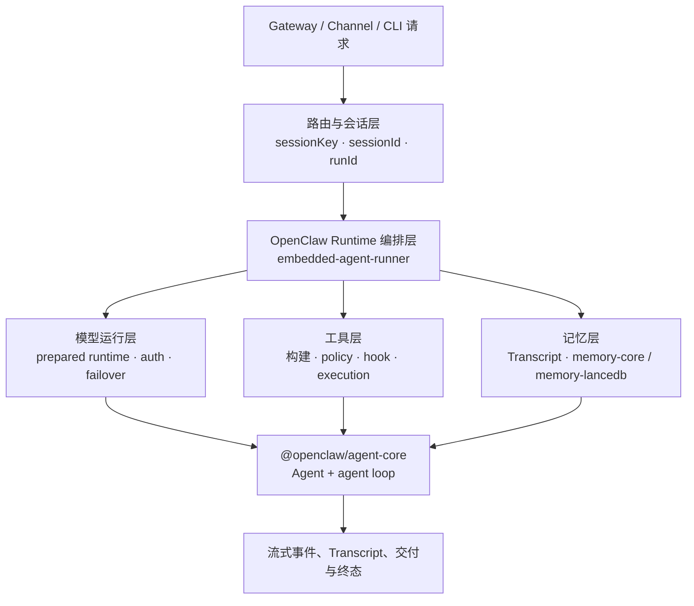
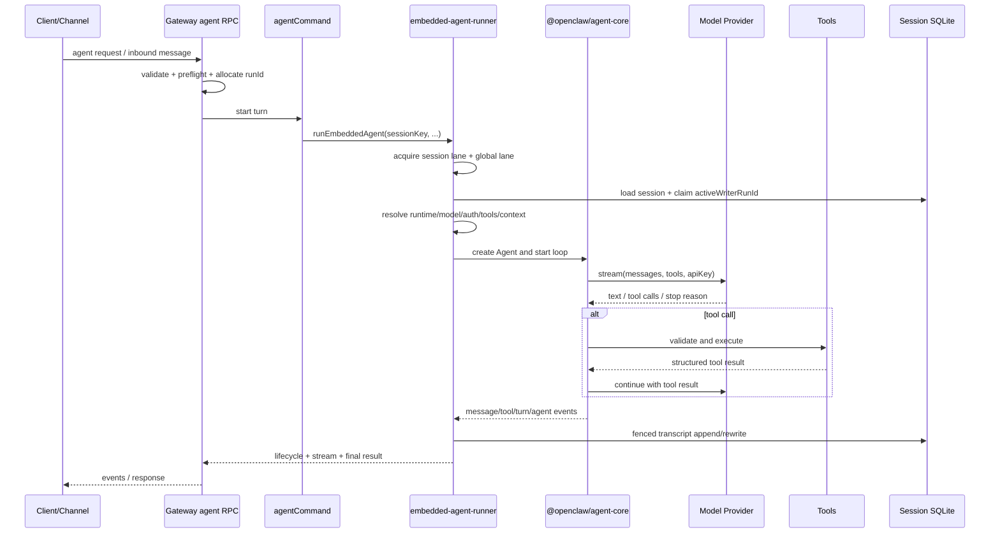
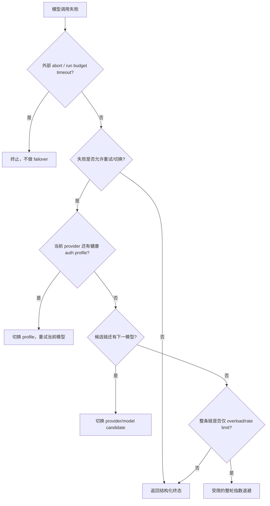
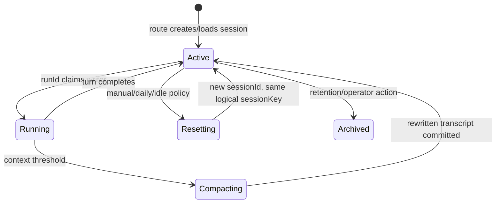

# Phase 4：Agent Runtime 执行、模型、工具、记忆与会话架构

> 目标：从当前源码出发，解释一条 Agent Turn 如何被创建、鉴权、调用模型、执行工具、读写记忆并落入隔离会话；同时给出二次开发时应遵守的模块边界。
>
> 分析基线：OpenClaw `2026.8.1`。本文描述的是当前实现，不把历史命名或可选插件误写成默认架构。

## 结论先行

当前 Agent Runtime 可以概括为六层：



首先要修正两个容易影响后续设计的前提：

| 原始理解                           | 当前源码事实                                                                                                                                              | 对二次开发的影响                                                                               |
| ---------------------------------- | --------------------------------------------------------------------------------------------------------------------------------------------------------- | ---------------------------------------------------------------------------------------------- |
| Agent 底层直接基于 `pi-agent-core` | Agent loop 已由仓库内 `packages/agent-core` 自有实现，包名为 `@openclaw/agent-core`；内置 runtime id 是 `openclaw`，`pi` 只保留为旧 runtime id 的兼容别名 | 不应对外部 pi-agent-core 的 API 做扩展；应从 OpenClaw runtime、Plugin SDK 或 harness seam 接入 |
| 长期记忆默认是 LanceDB             | 默认 memory slot 是 `memory-core`：以工作区 Markdown 为可审计事实源，并在每 Agent SQLite 中建立 keyword/vector/hybrid 索引；LanceDB 是可选官方外部插件    | 新功能不能假设每个部署都有 LanceDB，也不能把 `memory_recall`/`memory_store` 当作核心必有工具   |

五个关注点在源码中的真实归属如下：

| 能力              | 主要所有者                                                            | 核心职责                                                            |
| ----------------- | --------------------------------------------------------------------- | ------------------------------------------------------------------- |
| Agent loop        | `packages/agent-core/**`                                              | 消息循环、模型流、tool call、steering/follow-up、事件序列           |
| OpenClaw 运行编排 | `src/agents/embedded-agent-runner/**`、`src/agents/runtime/**`        | 会话准备、runtime/harness 选择、上下文、重试、Transcript 与最终交付 |
| 模型与认证        | `src/agents/prepared-model-runtime.ts`、`src/agents/auth-profiles/**` | 模型目录、OAuth/API key、凭据轮换、冷却状态                         |
| 工具              | `src/agents/agent-tools.ts`、`src/agents/tool-policy-pipeline.ts`     | 工具聚合、权限裁剪、Hook、审批、执行适配                            |
| 记忆              | `extensions/memory-core/**` 或 `extensions/memory-lancedb/**`         | 长期信息检索与写入；二者通过互斥 memory slot 接入                   |
| 会话              | `src/routing/**`、`src/config/sessions/**`、`src/sessions/**`         | sessionKey 路由、SQLite 状态、并发串行化、reset/compaction/归档     |

---

## 1. 底层框架：Agent Runtime 的真实分层

### 1.1 `@openclaw/agent-core` 负责什么

`packages/agent-core/src/agent.ts` 提供有状态 `Agent` 包装器，持有：

- 当前 transcript messages；
- model、system prompt 和 tools；
- `streamFn`、`getApiKey` 等由上层注入的运行依赖；
- steering 与 follow-up 队列；
- tool execution 模式及事件订阅。

`packages/agent-core/src/agent-loop.ts` 才是最内层循环。其稳定职责是：

1. 发出 `agent_start`、`turn_start`；
2. 将当前 transcript 转换为 LLM messages；
3. 调用注入的模型 stream 函数；
4. 将 assistant 流式增量和完成态写回消息序列；
5. 若模型返回 tool calls，校验参数并执行工具；
6. 为每个 tool call 生成配对的 tool result，包括跳过或失败结果；
7. 消费 steering/follow-up，决定继续当前 turn 还是进入下一 turn；
8. 发出 `turn_end`、`agent_end`。

Core 刻意不知道 Gateway、Channel、SQLite、某个模型厂商或某种长期记忆。它通过 `runtime-deps.ts` 注入 LLM stream、消息转换、tool schema 等依赖，因此是“Agent 状态机内核”，不是完整产品运行时。

### 1.2 OpenClaw 编排层补齐什么

`src/agents/embedded-agent-runner/run.ts` 及其拆分模块把 core 接入产品能力：

- 解析最终 agent/model/runtime；
- 获得 session lane 和 global lane；
- 准备 system prompt、skills、memory prompt、附件与历史消息；
- 取得认证 profile 和 provider API key；
- 构建经过权限裁剪的工具列表；
- 选择内置 OpenClaw runtime、插件 runtime 或 CLI backend；
- 驱动重试、failover、compaction、Transcript writer 与最终交付；
- 将底层事件投影为 Gateway/Channel 可消费的事件。

因此，“Runtime”不能只理解为一个 while loop。完整链路是：



### 1.3 Runtime 与 harness 的选择

OpenClaw 把 provider、model、runtime、channel 分成不同维度。模型名不会天然决定渠道，渠道也不拥有 Agent loop。

运行时选择大致遵循：

1. 如果显式指定 runtime，按注册表解析；插件 runtime 不存在时 fail closed；
2. 否则检查精确模型 claim；
3. 再检查 provider 范围 claim；
4. 没有插件接管时使用内置 `openclaw` runtime；
5. 满足条件时也可能走独立 CLI backend，而不是内置模型循环。

这意味着插件 runtime（例如某些 Codex/Pi 风格 harness）可能自行拥有模型 loop、工具协议或 compaction。本文后续的细节主要描述内置 `openclaw` runtime；对插件 runtime 二次开发时，必须重新核对该 runtime 声明的能力边界。

### 1.4 Prepared Model Runtime：把热路径事实提前准备

`src/agents/prepared-model-runtime.ts` 在配置、插件、认证数据稳定时生成按 Agent 划分的 runtime snapshot，其中包含模型目录、认证模板和 registry。每次 run 从快照取得 lease/fork，而不是在每次请求中反复扫描插件和配置。

设计意义：

- 一个 run 使用一致的模型与认证视图；
- 新配置以新的 generation 原子发布，不污染正在执行的 run；
- 避免在模型热路径做文件 freshness polling 或宽泛发现；
- 二次开发应把 process-stable metadata 放在准备阶段，而不是塞进每次 tool/model call。

---

## 2. 模型支持：OAuth、Failover 与 Rate Limit

### 2.1 模型选择不是单一字符串

实际选择结果至少包含 provider、model id、selection source、runtime/harness 以及可能的 fallback candidates。selection source 很重要，因为它决定是否允许自动 fallback：

| 来源                  | 一般语义                                     |
| --------------------- | -------------------------------------------- |
| 配置的默认模型        | 可以使用配置的 fallback chain                |
| Agent primary         | 默认严格；只有显式配置 fallbacks 才扩展      |
| 用户 session override | 用户明确选择，通常严格，不应悄悄改成另一模型 |
| Cron/job 配置         | 按任务自身的 model/fallback 声明             |

模型 fallback 是“本次 turn 的执行选择”，不会永久修改 session 中用户选定的模型。系统会记录并向用户呈现 fallback 或恢复通知，避免静默降级。

### 2.2 认证 profile 与 OAuth

认证凭据是按 Agent 隔离的。当前规范中，API key、静态 token、OAuth access/refresh token 存在每 Agent 的 SQLite 状态库；`openclaw.json` 中的 `auth.profiles`、`auth.order` 是声明与排序元数据，不应承载明文 secrets。

凭据类型主要包括：

| 类型                | 内容                          | Runtime 行为                                                        |
| ------------------- | ----------------------------- | ------------------------------------------------------------------- |
| `api_key`           | provider API key 或 SecretRef | 解析后直接用于 provider                                             |
| `token`             | 静态 bearer token             | 与允许的 bearer auth 模式匹配                                       |
| `oauth`             | access、refresh、expires 等   | 到期时通过 provider/plugin OAuth resolver 刷新并更新运行时 snapshot |
| provider-owned auth | 如插件或 SDK 认证             | 通过 provider runtime seam 解析，不在 core 硬编码                   |

`src/agents/auth-profiles/oauth.ts` 的关键边界是：

- 优先调用 provider plugin 的 OAuth credential resolver；
- provider 没有插件实现时，才使用内置 OAuth provider resolver；
- OAuth refresh token 竞态有专门识别与恢复路径；
- SecretRef 在 secrets runtime 中解析，不把值写进日志或回复；
- 更新后的凭据进入受控 store/runtime snapshot，而不是散落在 session transcript。

### 2.3 Profile 选择与粘性

`resolveAuthProfileOrderWithMetadata` 的选择规则可概括为：

1. 解析 provider alias 和兼容认证模式；
2. 使用显式 store/config `auth.order`，否则使用已配置或已存储 profiles；
3. 剔除缺失、不匹配、过期、未解析或当前不可用的 profile；
4. 显式顺序仍是主顺序，但处于 cooldown 的 profile 被移到健康 profile 后面；
5. 无显式顺序时按认证模式与 `lastUsed` 做轮换，避免一个健康 profile 永久饿死其他 profile；
6. session preferred profile 在可用时优先。

Session 会保留自动选中的 preferred profile，以减少每轮无意义切换。reset、compaction 或 profile cooldown 等边界会清理/重新选择；用户明确 pin 的 profile 则按严格选择处理，不能偷偷轮换成其他账号。

### 2.4 两级 Failover

模型调用失败不是直接换模型，而是先判断失败分类、是否已经产生副作用，再按两级策略处理：



第一级是同一 provider 内的 auth profile rotation；第二级才是 model fallback candidate。`FailoverError` 保存结构化 attempts，便于 UI、日志和上层判断失败发生在哪个候选。

### 2.5 Rate Limit 的处理不是只看 HTTP 429

运行时把 provider 返回的并发上限、resource exhausted、usage window、明确的 rate-limit envelope 等归为限流类信号。处理包含四部分：

1. **Profile cooldown**：临时失败按错误次数进入 30 秒、1 分钟、最高 5 分钟的短冷却；
2. **Model-scoped cooldown**：当证据表明只是某模型受限时，可只阻止该 profile+model 组合；不同模型连续失败会扩大为 profile 范围；
3. **Disabled lane**：billing 默认从 5 小时起、最高 24 小时；高置信永久认证错误默认从 10 分钟起、最高 60 分钟；
4. **Whole-turn overload retry**：整条候选链都只出现 overload 时，可在尚未产生工具副作用或可见 assistant 输出的前提下进行有限整轮退避；退避从约 2.5 秒增长，单次最高约 30 秒，并有总次数上限。

这里最重要的安全不变量是“不能因为 failover 重复副作用”。一旦工具已经执行、assistant 输出已对用户可见，或 harness 的超时归属不安全，retry controller 不应简单重放整个 turn。

### 2.6 配置示意

下面只表达结构，profile id、provider/model 和 SecretRef 应按真实部署替换：

```json5
{
  auth: {
    profiles: {
      "provider-a:work": { provider: "provider-a", mode: "oauth" },
      "provider-a:backup": { provider: "provider-a", mode: "api_key" },
    },
    order: {
      "provider-a": ["provider-a:work", "provider-a:backup"],
    },
  },
  agents: {
    defaults: {
      model: {
        primary: "provider-a/model-x",
        fallbacks: ["provider-b/model-y"],
      },
    },
  },
}
```

二次开发 provider 时，不应在 Agent loop 中判断 HTTP 文本。正确入口是 provider runtime/auth resolver 和统一错误分类，使 profile cooldown、fallback、可见错误与可观测数据都能复用。

---

## 3. 工具系统

### 3.1 工具来源

`createOpenClawCodingTools` 聚合多个来源，但最终都适配成 Agent core 能消费的 tool definition：

- 基础 coding tools：read、write、edit、apply_patch；
- shell/process tools：exec、process；
- OpenClaw 系统工具：sessions、message、browser、automation 等；
- Channel 提供的能力；
- Plugin SDK `registerTool` 注册的插件工具；
- MCP/工具 bundle；
- Tool Search 动态暴露的控制工具；
- client-hosted/ring-zero 工具。

工具“已经注册”不等于“当前模型可以看到”。真正传给模型的工具是配置、会话、发送者、sandbox、provider/model、owner 权限等策略的交集。

### 3.2 工具构建流水线


策略层遵守 deny wins。`tool-policy-pipeline.ts` 把默认层和 conversation 层显式排序，避免每个工具自己推断权限。被策略隐藏的工具不会出现在模型 schema 中；这比让模型看到后再报“无权限”更安全，也减少幻觉诱因。

### 3.3 一次 Tool Call 的生命周期

1. 模型返回结构化 tool call；
2. Agent core 按 schema 校验参数；
3. adapter 执行 `before_tool_call` Hook、审批、client delegation 等前置逻辑；
4. 运行工具并生成标准 content/details；
5. 失败被格式化和脱敏，不能泄漏凭据；
6. Agent core 发出 tool execution 事件，并将配对 result 加入 transcript；
7. 模型基于结果继续生成。

工具默认可并行；当全局设置 sequential 或任一工具要求顺序执行时，该批次串行。Steering 到达时，未启动的 calls 可以被跳过，但已经运行的工具不会被假装撤销；被跳过 call 仍得到合成 result，确保 transcript 协议完整。

### 3.4 四个不能混为一谈的安全层

| 层          | 解决的问题                           |
| ----------- | ------------------------------------ |
| Tool policy | 模型能否看见/调用某工具              |
| Sandbox     | 工具运行时能访问哪些文件、网络与进程 |
| Elevated    | 是否允许突破特定 sandbox 限制        |
| Approval    | 高风险调用是否必须人工确认           |

例如，仅把 `exec` 从 allow list 移除，并不能代替 sandbox；允许 `exec` 也不代表默认获得 elevated。二次开发必须分别设计这四层。

### 3.5 自定义工具的推荐接入方式

外部能力应通过插件公开入口注册：

```ts
export default definePluginEntry({
  id: "my-tools",
  register(api) {
    api.registerTool({
      name: "lookup_order",
      description: "按订单号读取当前用户有权访问的订单状态",
      parameters: Type.Object({ orderId: Type.String() }),
      async execute(_callId, args, ctx) {
        // 1. 用 ctx 中的可信身份做授权；2. 调用后端；3. 返回有界结构化结果
      },
    });
  },
});
```

设计清单：

- schema 必须有界，参数和返回内容均限制长度；
- 权限基于可信运行上下文，不接受模型自己声明 user/tenant；
- 写操作明确副作用、幂等键、审批和可见结果；
- 不在插件生产代码 deep import `src/**`；
- 不让 Channel 复制产品工具树，Channel 只映射 transport 能力；
- 使用 sessionKey/process scope 隔离长进程，禁止跨会话查看或终止别人的进程。

---

## 4. 记忆系统：三种状态必须分开

### 4.1 总体模型

| 层                  | 事实源/存储                                             | 生命周期                                       | 是否默认           |
| ------------------- | ------------------------------------------------------- | ---------------------------------------------- | ------------------ |
| 当前上下文          | 本轮 Agent messages                                     | 一次运行中的上下文窗口                         | 是                 |
| 短期会话 Transcript | 每 Agent SQLite 的 session/transcript 数据              | 同一 `sessionId` 生命周期，可 compaction/reset | 是                 |
| 内置长期记忆        | `MEMORY.md`、`USER.md`、`memory/*.md` + SQLite 检索索引 | 跨 session，可人工审阅                         | `memory-core` 默认 |
| LanceDB 向量记忆    | LanceDB 表 + embedding                                  | 跨 session，按 Agent namespace                 | 可选插件           |

JSONL 目前属于旧数据迁移、归档、导入导出或支持性表面，不是当前 session transcript 的权威运行时存储。新代码不要重新引入 JSON/JSONL sidecar 作为状态库。

### 4.2 短期记忆：Session Transcript

Transcript 是模型看到的对话与 tool results 的连续记录。它同时服务于：

- 下一轮上下文重建；
- 流式消息和工具事件的持久化；
- compaction 前后的上下文连续性；
- run 恢复、投影和审计。

当上下文逼近模型窗口时，compaction 会把较旧内容总结为紧凑上下文。Compaction 不等于新建逻辑会话：`sessionKey` 不变，通常也不是用户意义上的 reset；它是同一会话生命周期中的上下文重写，必须受 writer fence 保护。

### 4.3 默认长期记忆：`memory-core`

默认 memory plugin 以可读 Markdown 为事实源，并把它们索引到该 Agent 的 SQLite：

- `MEMORY.md`：相对稳定的长期事实；
- `USER.md`：用户相关事实；
- `memory/*.md`：按主题或日期组织的记忆；
- 可选 session transcript corpus。

检索能力包括 FTS5/BM25 keyword、embedding vector、hybrid、MMR、时效性/重要性/来源等信号。没有 embedding 能力时仍可以降级为 keyword search；有 sqlite-vec 时可在 SQLite 内做向量查询，否则可使用进程内 cosine 路径。

暴露给 Agent 的主要工具是 `memory_search` 与 `memory_get`。这套设计强调“文件可人工查看和修订，索引可重建”，因此索引不是事实源。

### 4.4 可选长期记忆：`memory-lancedb`

LanceDB 插件通过互斥 memory slot 接管记忆能力，注册：

- `memory_recall`：按向量相关性召回；
- `memory_store`：显式存储；
- `memory_forget`：查找并删除；
- `before_prompt_build`：可选自动召回；
- `agent_end`：可选自动捕获；
- `session_end`：清理自动捕获 cursor。

默认配置语义：

| 配置                 | 默认                                  | 说明                                          |
| -------------------- | ------------------------------------- | --------------------------------------------- |
| `autoRecall`         | `true`                                | 在 prompt 构建前召回                          |
| `autoCapture`        | `false`                               | 默认不自动把用户内容写入长期记忆              |
| `embedding.provider` | `openai`                              | embedding 配置整体必需，可换 provider adapter |
| `dbPath`             | OpenClaw memory 目录下的 LanceDB 路径 | 可覆盖                                        |
| `captureMaxChars`    | `500`                                 | 自动捕获候选的字符上限，配置范围 100–10000    |
| `recallMaxChars`     | `1000`                                | embedding 召回查询字符上限，范围 100–10000    |

启用示意：

```json5
{
  plugins: {
    slots: { memory: "memory-lancedb" },
    entries: {
      "memory-lancedb": {
        enabled: true,
        config: {
          embedding: {
            provider: "openai",
            model: "text-embedding-3-small",
            apiKey: "${OPENAI_API_KEY}",
          },
          autoRecall: true,
          autoCapture: false,
        },
      },
    },
  },
}
```

`embedding.apiKey` 当前是支持 `${ENV_VAR}` 展开的字符串；也可以省略它，让 provider adapter 复用已有 auth profile、环境变量或 provider 配置。密钥不应直接提交到仓库。

### 4.5 自动召回流程

`before_prompt_build` 的自动召回有明确边界：

1. 仅对启用该记忆插件的 Agent 生效；
2. 提取最新 user text，删除媒体提示行并按 `recallMaxChars` 截断；
3. embedding 与 search 受超时/熔断保护，失败只跳过记忆注入，不阻塞 Agent 启动；
4. 查询时先按 agent namespace 限定所有权，再做向量排名；
5. overfetch 后清理污染内容，最多注入 3 条；
6. 记忆以不可信历史数据的形式 prepend 到 context，不能被当作系统指令。

### 4.6 自动捕获流程

`agent_end` 只在 `autoCapture: true`、run 成功、存在消息且不是 incognito 时运行：

1. 用 `agentId + sessionKey/sessionId` cursor 找到本次新增消息；
2. 只提取用户文本；
3. 清理 envelope、已召回块和疑似 prompt injection；
4. 按 triggers 和 `captureMaxChars` 判断是否值得长期保存；
5. 每 turn 最多处理 3 条候选；
6. embedding 后先查近似重复，再写入带 category、importance 的 Agent namespace；
7. `session_end` 清理 cursor。

因此“自动捕获”不是把整段 transcript 无差别向量化。它是可关闭、有触发器、有数量上限、去重、按 Agent 隔离且跳过隐身会话的插件策略。

### 4.7 选择 memory-core 还是 LanceDB

| 场景                                       | 推荐                                                                 |
| ------------------------------------------ | -------------------------------------------------------------------- |
| 需要可审计、可人工修改、零向量服务也可检索 | `memory-core`                                                        |
| 希望默认行为简单且与官方核心路径一致       | `memory-core`                                                        |
| 需要高频结构化自动捕获和纯向量召回         | 评估 `memory-lancedb`                                                |
| 多租户、强合规、需要删除证明               | 先设计 namespace、删除、备份和审计，再决定；不能仅因“有向量库”就启用 |

---

## 5. 会话管理：sessionKey 隔离与生命周期

### 5.1 三种 ID

| 标识         | 含义                                   | 何时变化                                |
| ------------ | -------------------------------------- | --------------------------------------- |
| `sessionKey` | 逻辑会话、路由、权限和并发桶的稳定 key | 路由目标或 scope 改变时；reset 通常不变 |
| `sessionId`  | 当前 transcript generation 的 UUID     | reset/新生命周期时轮换                  |
| `runId`      | 一次 Agent 执行/turn 的 owner          | 每次执行新建                            |

混淆三者会产生典型错误：用 sessionId 做长期路由会在 reset 后失联；用 sessionKey 当 writer owner 会让旧 run 覆盖新 run；用 runId 做历史查询又无法跨 turn 连续。

### 5.2 sessionKey 语法与隔离模式

主会话规范形式为：

```text
agent:<agentId>:<mainKey>
```

`mainKey` 默认是 `main`。DM 的 `dmScope` 决定不同用户是否共享：

| `dmScope`                  | key 形态                                            | 隔离含义                 |
| -------------------------- | --------------------------------------------------- | ------------------------ |
| `main`                     | `agent:<agentId>:main`                              | 所有 DM 进入同一个主会话 |
| `per-peer`                 | `agent:<agentId>:direct:<peer>`                     | 同一身份跨渠道可合并     |
| `per-channel-peer`         | `agent:<agentId>:<channel>:direct:<peer>`           | 按渠道和对端隔离         |
| `per-account-channel-peer` | `agent:<agentId>:<channel>:<account>:direct:<peer>` | 多账号部署的最强 DM 隔离 |

群组/频道通常为：

```text
agent:<agentId>:<channel>:<kind>:<peerId>
```

Thread 再追加：

```text
:thread:<threadId>
```

`identityLinks` 可以在 `per-peer` 等模式下把同一自然人在不同渠道的身份规范化为同一 peer，但这是显式身份配置，不应靠显示名猜测。

注意两个“全局”的区别：

- `dmScope: main` 表示某 Agent 的 DM 共享主 session；
- `session.scope: global` 返回特殊全局 key，是另一套兼容/系统语义。

产品上说“全局模式”时必须先说明指哪一个。多人环境把 DM 留在 `main` 会造成上下文串线风险，通常至少应使用 `per-channel-peer`。

### 5.3 Multi-Agent 隔离

Agent binding 先根据 channel/account/peer 等事实选择 `agentId`，再由该 Agent 的 session 配置生成 key。因此隔离顺序是：

```text
入站事实 → binding 选择 agentId → 规范化 peer/thread → 生成 sessionKey
```

每个 Agent 有独立的工作区、认证状态、session SQLite 和记忆 namespace。共享一个 Gateway 不代表共享会话或凭据。

### 5.4 并发与队列

同一个 session 的 run 首先进入 `session:<sessionKey>` lane 串行执行，然后再受 global lane 最大并发限制。结果是：

- 同一会话不会同时有两个普通 turn 竞争 Transcript；
- 不同 session 可以并发；
- Gateway 仍能用全局并发上限保护模型、CPU 和外部 API。

运行中再次收到消息时，queue mode 决定行为：

| 模式        | 行为                                             |
| ----------- | ------------------------------------------------ |
| `steer`     | 尽快注入当前 Agent loop，影响后续模型/未启动工具 |
| `followup`  | 当前 turn 结束后继续一个新 turn                  |
| `collect`   | 合并积累的消息后处理                             |
| `interrupt` | 请求中断当前 run，再处理新消息                   |

默认 `steer` 强调连续对话；对不可撤销工具较多的场景，应额外评估 interrupt 与审批语义。

### 5.5 生命周期状态



默认没有自动 reset；部署可以配置 daily、idle、manual 以及按会话类型/channel 的 reset policy。判断字段包括：

- `sessionStartedAt`：本 transcript generation 的起点；
- `lastInteractionAt`：最近用户/Agent 交互；
- `updatedAt`：更广泛的记录更新时间。

Reset 会归档旧 transcript 并生成新 sessionId；Compaction 只压缩当前生命周期。二者不能混用。

### 5.6 Transcript 写入一致性

SQLite session row 中的 `activeWriterRunId` 是写所有权。Transcript append/rewrite 在事务内同时校验：

- 目标 session/lifecycle 仍是预期 generation；
- 当前 runId 仍是 active writer；
- 写入上下文没有被 reset/compaction 替换。

被新 run、reset 或恢复流程取代的旧 run 即使晚到，也不能提交旧 transcript。这是比“只靠 session lane”更强的持久化 fencing，解决进程调度、异步模型响应和生命周期切换之间的竞态。

`agent.wait` 只等待 runId 到达终态；wait 自身超时不会自动终止后台 run。客户端不能把 wait timeout 当作 Agent 已取消。

### 5.7 Retention 与隐身会话

Session maintenance 可按 `pruneAfter`、`maxEntries` 等策略清理普通会话，归档记录有独立语义。Incognito 使用专用 key/进程内状态，不落普通持久存储，并阻止自动长期记忆捕获。

---

## 6. 一条完整 Agent Turn 的状态流

1. Channel 或客户端提交消息；Gateway 验证请求、幂等与权限。
2. Route binding 确定 `agentId`，按 DM/group/thread 规则生成 `sessionKey`。
3. Gateway 分配 `runId`；加载 session row 和当前 `sessionId`。
4. Run 进入 session lane，再进入 global lane，并 claim `activeWriterRunId`。
5. 从 prepared model runtime generation 解析 model、runtime、auth profiles。
6. 加载 Transcript，执行 reset/compaction 前置判断。
7. memory plugin 准备记忆上下文；LanceDB 自动召回若开启，会在 prompt build 前注入。
8. 构建 system prompt、skills、附件和经过 policy 裁剪的 tools。
9. `@openclaw/agent-core` 调用模型 stream；OAuth 需要时刷新。
10. 模型发起 tool calls；Hook、审批、sandbox 和 adapter 执行工具。
11. Tool results 回填 transcript，core 继续模型循环；steering/follow-up 可改变后续流程。
12. 失败时先判断是否安全 retry，再做 profile rotation、model fallback 或有限 overload backoff。
13. Runner 用 writer fence 持久化 Transcript，记录 run terminal outcome 和交付状态。
14. `agent_end` hooks 运行；LanceDB 仅在明确启用 autoCapture 且非 incognito 时捕获。
15. Gateway/Channel 向用户输出 final 或明确的失败/非交付原因。

---

## 7. 二次开发应从哪里接入

### 7.1 决策表

| 需求                    | 推荐入口                                          | 不推荐做法                                   |
| ----------------------- | ------------------------------------------------- | -------------------------------------------- |
| 新模型 provider / OAuth | Provider plugin/runtime auth seam                 | 修改 Agent loop、按错误字符串硬编码 provider |
| 新 runtime/harness      | Runtime plugin registry 与公开 runtime contract   | 把 `pi` 兼容 alias 当作扩展 API              |
| 新业务工具              | Plugin SDK `registerTool`                         | 插件 deep import `src/agents/**`             |
| 新工具权限              | 复用 tool policy、owner/sender/group/sandbox gate | 工具内部各写一套隐式 allowlist               |
| 新长期记忆后端          | 实现 memory plugin/slot 与有界工具、Hook          | 同时启用两套 memory owner 或写 JSON sidecar  |
| 新会话模式              | 优先复用 binding、dmScope、thread key             | 在 Channel 内自造 session id 或用显示名路由  |
| 新客户端                | 通过 Gateway typed API 和事件                     | 直接操作 Agent SQLite/Transcript             |

### 7.2 最小配置核对

1. **Agent**：agentId、workspace、default model；
2. **Model**：primary/fallbacks、provider catalog、认证 profile 与顺序；
3. **Session**：dmScope、reset policy、queue mode、retention；
4. **Tools**：profile、allow/deny、sandbox、elevated、approval、owner 范围；
5. **Memory**：选择唯一 memory slot，设置 embedding、自动召回/捕获与数据保留；
6. **Channel/client**：binding、account、peer/thread 规范和可靠交付；
7. **Observability**：runId、sessionKey、selected model/profile、fallback attempts、tool outcome、delivery outcome。

### 7.3 建议验收矩阵

| 场景                                           | 预期结果                                                    |
| ---------------------------------------------- | ----------------------------------------------------------- |
| 两个 DM 用户在 `per-channel-peer` 下同时发消息 | sessionKey 不同、Transcript/工具进程/记忆不串线             |
| 同一 session 连续快速发送两条消息              | 按 queue mode steer/follow-up，且 Transcript 顺序一致       |
| OAuth access token 到期                        | refresh 成功后继续；敏感值不出现在日志/transcript           |
| 主 profile 被限流                              | 进入 model/profile 范围正确的 cooldown，并轮换健康 profile  |
| 当前 provider 全部不可用                       | 仅在 selection policy 允许时进入下一 fallback model         |
| 工具已经完成后模型报错                         | 不整轮盲目重放，避免重复副作用                              |
| deny 某工具                                    | 工具 schema 不发送给模型，调用路径不可达                    |
| Compaction 与旧 run 晚到并发                   | writer fence 拒绝旧 run 覆盖新 transcript                   |
| LanceDB autoRecall 超时                        | 跳过记忆、不阻塞 Agent turn                                 |
| `autoCapture: false`                           | `agent_end` 不写入 LanceDB                                  |
| Incognito 会话                                 | 不持久化普通 session，不自动捕获长期记忆                    |
| reset session                                  | sessionKey 保持逻辑连续、sessionId 轮换、旧 transcript 归档 |

---

## 8. 已知事实、待确认项与主要风险

### 已知事实

- 当前内置 Agent core 是 `@openclaw/agent-core`，不是外部 `pi-agent-core`；
- 默认 memory slot 是 `memory-core`，LanceDB 属于可选插件；
- session、认证状态和默认记忆索引使用每 Agent SQLite；
- profile rotation 与 model fallback 是两级机制；
- tool visibility 在模型调用前由多层 policy 裁剪；
- sessionKey、sessionId、runId 分别承担逻辑路由、Transcript generation、单次执行所有权。

### 待确认项

- 目标部署是否需要插件 runtime，还是全部使用内置 OpenClaw runtime；
- 用户是单人还是多人，多渠道身份是否需要 `identityLinks`；
- 长期记忆需要“人工可审阅”还是“自动捕获优先”；
- 自定义工具有哪些写副作用、审批、幂等和租户权限要求；
- OAuth provider 是否已有官方/社区 plugin，新增前应先完成现有方案检查；
- 数据保留、删除、备份和向量服务是否满足组织合规要求。

### 主要风险

1. **会话串线**：多人部署仍使用 `dmScope: main`；
2. **重复副作用**：在工具完成后做整轮 retry/failover；
3. **权限只做一层**：把 tool policy、sandbox、elevated、approval 混为一谈；
4. **记忆污染**：自动捕获无上限，或把召回内容当可信系统指令；
5. **插件耦合 core**：从插件 deep import `src/**`，升级时失去兼容边界；
6. **把索引当事实源**：无法重建、审计或正确删除长期记忆；
7. **热路径重复发现**：每次请求扫描 provider/plugin/config，破坏 generation 一致性；
8. **可见结果缺失**：失败、fallback 或未交付没有向操作者说明。

---

## 9. 源码导航

| 主题                 | 关键源码/文档                                                                                                                                                                                |
| -------------------- | -------------------------------------------------------------------------------------------------------------------------------------------------------------------------------------------- |
| Agent core           | `packages/agent-core/src/agent.ts`、`packages/agent-core/src/agent-loop.ts`、`packages/agent-core/src/runtime-deps.ts`                                                                       |
| Runtime 架构         | `docs/agent-runtime-architecture.md`、`docs/concepts/agent-loop.md`、`src/agents/runtime/index.ts`                                                                                           |
| Embedded runner      | `src/agents/embedded-agent-runner/run.ts`、`run-loop.ts`、`run-orchestrator.ts`、`run-entry.ts`                                                                                              |
| Runtime 选择         | `src/agents/harness/selection.ts`、`registry.ts`、`runtime-plugin.ts`                                                                                                                        |
| Prepared model state | `src/agents/prepared-model-runtime.ts`                                                                                                                                                       |
| OAuth/auth profiles  | `src/agents/auth-profiles/oauth.ts`、`order.ts`、`usage.ts`                                                                                                                                  |
| Failover             | `src/agents/model-fallback-candidates.ts`、`model-fallback-runner.ts`、`src/agents/embedded-agent-runner/run/failover-policy.ts`                                                             |
| Tools                | `src/agents/agent-tools.ts`、`tool-policy-pipeline.ts`、`agent-tools.finalize.ts`、`agent-tool-definition-adapter.ts`                                                                        |
| 默认记忆             | `extensions/memory-core/index.ts`、`extensions/memory-core/src/memory/index.ts`、`docs/concepts/memory.md`                                                                                   |
| LanceDB              | `extensions/memory-lancedb/index.ts`、`config.ts`、`memory-policy.ts`、`docs/plugins/memory-lancedb.md`                                                                                      |
| Session key          | `src/routing/session-key.ts`、`src/config/sessions/session-key.ts`、`src/routing/resolve-route.ts`                                                                                           |
| Session lifecycle    | `src/config/sessions/session-accessor.lifecycle.ts`、`session-accessor.reset.ts`、`src/sessions/session-lifecycle-admission.ts`                                                              |
| Transcript fencing   | `src/config/sessions/session-accessor.sqlite-transcript-write.ts`、`src/config/sessions/transcript-write-context.ts`、`src/agents/embedded-agent-runner/run/attempt-transcript-lifecycle.ts` |

## 最终建议

后续拆分 Agent Runtime 时，建议不要按“模型、工具、记忆、会话各自一套服务”直接物理拆进程，而应先守住三个核心不变量：

1. **一次 run 使用一致的 prepared generation**：模型、认证、工具、记忆 prompt 不在中途漂移；
2. **sessionKey 决定隔离，runId 决定写所有权**：并发控制和持久化 fencing 缺一不可；
3. **所有副作用都必须可判定是否已经发生**：只有这样 failover、重试、恢复与交付才能安全。

在这三个不变量之上，模型 provider、业务工具、记忆后端和客户端都可以通过已有公开 seam 独立替换；破坏它们，则即使模块图更“微服务化”，也会引入会话串线、重复执行和静默失败。
