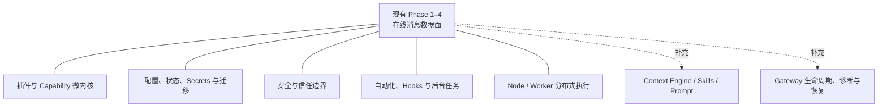

# 前四节架构覆盖审计与补充建议

> 目标：基于 `phase1_client_gateway_integration_analysis.md` 至 `phase4_agent_runtime_architecture.md` 的现有拆分，从 Gateway 启动编排、顶层模块所有者、公共 SDK 和持久化生命周期反向检查，确认尚未覆盖的核心架构。
>
> 分析基线：OpenClaw `2026.8.1` 当前源码。本文是后续拆分建议，不替代 Phase 1–4 已有内容。

## 全局审计结论

Phase 1–4 已经完整覆盖 OpenClaw 的“在线消息主链”：

```text
客户端
  → Gateway 通信协议
  → Channel 输入输出
  → Agent Runtime
  → 模型 / 工具 / 记忆 / Session
```

但当前四个 Phase 还不能代表全部核心架构。至少还有五个核心域，以及两个需要补充的横切域：



| 优先级 | 核心架构                         | 当前覆盖情况                                               | 审计判断                        |
| ------ | -------------------------------- | ---------------------------------------------------------- | ------------------------------- |
| P0     | 插件微内核与 Capability 系统     | Phase 3 只讲 Channel；Phase 4 零散提到工具、模型、记忆插件 | 必须单独拆分                    |
| P0     | 配置、状态、Secrets 与迁移       | 四个 Phase 只在具体功能中引用配置和 SQLite                 | 必须单独拆分                    |
| P0     | 安全与信任边界                   | 客户端认证、Channel 安全、工具权限分别出现过               | 缺少全局安全模型                |
| P0     | 自动化、Hooks 与后台任务         | Phase 4 只把 automation 当作工具来源                       | 必须单独拆分                    |
| P0     | Node/设备分布式执行              | Phase 1–2 讲了 node 客户端接入，但没讲服务端执行架构       | 需要继续深入                    |
| P1     | Context Engine、Skills 与 Prompt | Phase 4 只描述准备 system prompt、skills、context          | 建议作为 Phase 4 补充或独立文档 |
| P1     | Gateway 生命周期、诊断与恢复     | Phase 2 偏客户端接口；系统说明只到目录级                   | 未在既有 Gateway 文档覆盖时补充 |

---

## 1. 插件微内核与 Capability 系统

这是目前最明显的核心遗漏。

Phase 3 详细解释了 `ChannelPlugin`，但 Channel 只是插件系统的一种 Capability。当前插件注册表还支持：

- Text inference Provider；
- CLI inference backend；
- Agent harness；
- Embedding Provider；
- Speech、Realtime Voice、Transcription；
- Media understanding；
- Image、Music、Video generation；
- Web Search、Web Fetch；
- Gateway Method；
- HTTP/WebSocket Route；
- Service、Hook、CLI Command；
- Node Host Command；
- Tool、Session Extension；
- Worker Provider；
- Memory/Context Engine 等互斥 slot。

完整插件生命周期是：

```text
安装记录
 → manifest discovery
 → metadata snapshot
 → enablement / trust / slot selection
 → activation planning
 → runtime module load
 → register(api)
 → central registry
 → Gateway / Agent / Channel 消费 Capability
 → reload / disable / rollback / cleanup
```

后续文档需要重点解释：

- 控制面和运行面的分离；
- manifest-first、未执行插件代码的 discovery；
- metadata snapshot 与 runtime registry 的区别；
- activation planner 如何按 provider、channel、command、route、capability 惰性加载；
- 插件注册失败后的副作用回滚；
- bundled、external、workspace、config path 的信任差异；
- Plugin SDK 的稳定边界；
- Capability 与 Plugin 的区别；
- memory、context engine 等 exclusive slot；
- MCP bundle 和 native code plugin 的区别。

关键源码：

- `src/plugins/activation-planner.ts`
- `src/plugins/loader.ts`
- `src/plugins/registry.ts`
- `src/plugins/api-builder.ts`
- `src/plugin-sdk/AGENTS.md`
- `docs/plugins/architecture.md`

### 1.1 模型 Provider 架构也应纳入本阶段

Phase 4 已解释 OAuth、Rate Limit 和 Failover，但尚未覆盖：

- 静态与动态 Model Catalog；
- Provider Plugin 的认证、配置、目录、transport 四层职责；
- stream function 创建和包装；
- replay/compaction policy；
- tool schema 兼容；
- reasoning output；
- provider-owned prompt contribution；
- embedding、speech、media 等同厂商多 Capability 注册。

关键契约：

- `src/plugins/provider-plugin.types.ts`
- `src/plugins/provider-runtime.types.ts`
- `src/plugins/provider-transport.types.ts`
- `src/model-catalog/manifest-planner.ts`

建议命名：

```text
phase5_plugin_capability_and_provider_architecture.md
```

---

## 2. 配置、状态、Secrets 与迁移架构

这是 Gateway 的权威控制面，也没有被四个 Phase 独立讲清楚。

### 2.1 配置生命周期

```text
openclaw.json / include / environment
 → JSON5 读取
 → schema validation
 → normalization
 → plugin config validation
 → SecretRef activation
 → immutable runtime snapshot
 → config diff
 → hot reload / channel reload / full restart
 → last-known-good / recovery
```

Gateway 不是每次请求重新读取配置文件，而是在启动和 reload 时发布有效 runtime snapshot。配置变化会被分类为：

- 无需处理；
- 可以原子热更新；
- 只重启对应 Channel；
- 必须重启 Gateway；
- reload 失败并保留 last-known-good。

关键源码：

- `src/config/io.load.ts`
- `src/config/io.write.ts`
- `src/gateway/config-reload.ts`
- `src/gateway/config-reload-plan.ts`

### 2.2 双 SQLite 状态模型

OpenClaw 至少存在两个核心状态所有者：

| 数据库          | 作用                                                                    |
| --------------- | ----------------------------------------------------------------------- |
| Shared State DB | Gateway 全局任务、Cron、插件 KV、设备、配对、团队 Secrets、共享运行状态 |
| Per-Agent DB    | Session、Transcript、认证 Profile、记忆索引、Agent 级状态               |

状态层还包含：

- schema version preflight；
- startup compatibility check；
- Kysely transaction；
- owner lease；
- lazy additive schema ensure；
- doctor migration；
- corruption quarantine；
- readonly、maintenance 和 checkpoint；
- 数据库写权限与进程所有权。

关键源码：

- `src/state/openclaw-state-db.ts`
- `src/state/openclaw-agent-db.ts`
- `src/state/openclaw-database-preflight.ts`

### 2.3 Secrets Runtime

Secrets 不只是“从环境变量取 API Key”。当前架构包括：

- `env/file/exec/store` 四种 SecretRef；
- 启动时集中解析并发布内存 snapshot；
- active/inactive surface 判断；
- owner 级 cold/stale/healthy 状态；
- last-known-good；
- provider credential sentinel；
- egress-time 注入；
- 精确值日志脱敏；
- audit/configure/apply/reload 工作流。

关键源码和文档：

- `src/secrets/runtime-prepare.runtime.ts`
- `src/secrets/runtime-degraded-state.ts`
- `docs/gateway/secrets.md`

建议命名：

```text
phase6_configuration_state_secrets_and_migration.md
```

---

## 3. 全局安全与信任边界

目前安全知识散落在四个 Phase 中，但缺少完整威胁模型。

需要统一描述以下信任层：

```text
网络暴露
 → Gateway 身份认证
 → Operator role/scopes
 → Device pairing
 → Channel sender admission
 → Agent/session 隔离
 → Tool policy
 → Approval
 → Sandbox/elevated
 → 文件与网络策略
 → Secret egress
 → Plugin/Skill 安装信任
 → 日志与诊断脱敏
```

这些安全层不能互相替代：

- Gateway token 不能代替设备配对；
- Channel allowlist 不能代替 command authorization；
- Tool deny 不能代替 Sandbox；
- Sandbox 不能代替审批；
- SecretRef 不能代替 OS 进程隔离；
- 一个 Gateway 的多个 Agent 不是敌对租户安全边界；
- 真正的强租户隔离需要独立 Gateway、cell 或 container。

关键源码：

- `src/security/**`
- `src/secrets/**`
- `src/agents/sandbox/**`
- `src/gateway/method-scopes.ts`
- `packages/net-policy/**`
- `docs/gateway/security/index.md`

这一部分可以并入 Phase 6，也可以单独形成安全架构文档。考虑其重要性，更建议独立拆分。

---

## 4. 自动化、Hooks 与后台任务架构

这是另一条与在线聊天平行的执行主链：

```text
Cron / every / at / stream / on-exit / webhook / heartbeat
 → Gateway Scheduler
 → persisted job
 → trigger admission
 → Task Registry
 → system event / Agent Turn / command / script
 → isolated/current/custom session
 → result delivery
 → run history / retry / lost reconciliation
```

当前实现包括：

- 一次性、固定间隔、Cron 表达式；
- stream command 和 on-exit 事件源；
- condition trigger；
- heartbeat system job；
- webhook/Gmail Hook；
- isolated Agent turn；
- command/script payload；
- Task Registry；
- timeout、cancel、cleanup；
- restart 后 reconciliation；
- delivery/failure notification；
- detached task 和子任务归属。

自动化并不是 Agent Runtime 的一个普通工具，而是 Gateway 中独立的后台执行与持久化系统。

关键源码：

- `src/cron/service.ts`
- `src/cron/types.ts`
- `src/tasks/task-registry.ts`
- `src/tasks/task-registry.types.ts`
- `src/gateway/server/hooks.ts`
- `docs/automation/cron-jobs.md`

建议命名：

```text
phase7_automation_hooks_and_task_runtime.md
```

---

## 5. Node 与分布式执行架构

Phase 1–2 已经解释了客户端为什么要拆分 operator/node 连接，但服务端的 Node Runtime 仍然没有展开。

完整 Node 链路包括：

```text
Node Host / Native App
 → device pairing identity
 → node-role WebSocket
 → capabilities / commands / permissions publication
 → Gateway NodeRegistry
 → session capability ceiling
 → node.invoke
 → command policy / approval
 → progress / result / cancel
 → stale connection fencing
```

Node 还可以动态发布：

- 系统命令；
- OS/硬件能力；
- Node-hosted Skills；
- Plugin tools；
- MCP tools；
- PATH 和运行环境；
- 实时权限状态。

服务端 `NodeRegistry` 负责连接租约、pairing generation、pending invokes、进度流、慢消费者和断线清理，而不是简单转发 RPC。

关键源码：

- `src/gateway/node-registry.ts`
- `src/node-host/runner.ts`
- `src/node-host/invoke.ts`
- `packages/gateway-protocol/src/schema/nodes.ts`
- `docs/nodes/index.md`

`src/worker/**` 是更严格的云 Worker 执行面：模型调用、Transcript commit 和 live events 都经 Gateway RPC，并使用 owner epoch 做 fencing。但当前文档明确把它定位为受限、编排器启动的内部能力，不应与普通 Node 一起当成默认接入方案。

`fleet` 目前也是实验性租户 cell 管理，不建议纳入第一版核心架构，只需在隔离部署章节说明。

建议命名：

```text
phase8_node_and_distributed_execution_architecture.md
```

---

## 6. 建议补充但不一定独立成 Phase 的模块

### 6.1 Context Engine、Skills 与 Prompt Assembly

Phase 4 讲清楚了 Agent loop，但没有完整解释“模型最终看到了什么”。

仍需补充：

- bootstrap files；
- system prompt 分层；
- Skill discovery、优先级、allowlist 和 snapshot；
- Plugin Skill、Node-hosted Skill；
- context budget；
- Context Engine `ingest/assemble/compact/commitTurn`；
- prompt cache；
- durable turn advancement；
- memory prompt preparation；
- subagent context inheritance；
- prompt injection 与 external content trust。

关键源码：

- `src/context-engine/types.ts`
- `src/skills/**`
- `src/skills/types.ts`
- `docs/concepts/context-engine.md`
- `docs/tools/skills.md`

建议作为 `phase4_agent_runtime_architecture.md` 的补充文档，而不是重新解释 Agent loop：

```text
phase4_addendum_context_skills_and_prompt_assembly.md
```

### 6.2 Gateway 生命周期、可观测与恢复

Gateway 启动实际分为：

```text
DB schema preflight
 → config snapshot
 → Secret activation
 → plugin metadata
 → runtime state
 → HTTP/WS attach
 → plugin/model/channel/cron startup
 → readiness
 → post-ready work
```

关闭时还有 drain、terminal/session 清理、任务停止、plugin hook、sidecar 停止和数据库关闭等反向顺序。

关键源码：

- `src/gateway/server-start.ts`
- `src/gateway/server-startup-bootstrap.ts`
- `src/gateway/server-core-runtime.ts`
- `src/gateway/server-close.ts`

可观测体系包括：

- subsystem logs；
- health/readiness；
- event-loop health；
- diagnostic events；
- stability bundle；
- trajectory；
- OTEL/Prometheus 插件。

如果此前的 Gateway 核心文档已经覆盖这些内容，无需再单独拆分；否则建议增加：

```text
phase9_gateway_lifecycle_observability_and_recovery.md
```

---

## 7. 不建议升格为核心架构的模块

以下模块很重要，但更适合作为能力专题，不应和前述基础骨架同级：

- 图片、视频、音乐生成；
- TTS、Talk、Realtime Voice；
- Media Understanding；
- Browser、Canvas、Computer Use；
- Workboard、Dashboard；
- Web Search、Web Fetch；
- 各个具体模型 Provider；
- 各个具体 Channel；
- Fleet 的详细容器操作；
- 单个业务插件。

这些能力大多复用 Plugin Capability、Tool、Task、Node 和 Gateway 协议。先把底层扩展合同写清楚，再按需要写能力专题即可。

---

## 8. 推荐的最终架构拆分

建议在现有 Phase 1–4 后增加四个核心 Phase：

1. `phase5_plugin_capability_and_provider_architecture.md`
2. `phase6_configuration_state_secrets_and_security.md`
3. `phase7_automation_hooks_and_task_runtime.md`
4. `phase8_node_and_distributed_execution_architecture.md`

同时给 Phase 4 增加一个补充文档：

```text
phase4_addendum_context_skills_and_prompt_assembly.md
```

如果此前的 Gateway 核心文档没有覆盖启动、热更新、关闭、诊断与恢复，再增加：

```text
phase9_gateway_lifecycle_observability_and_recovery.md
```

## 最终判断

现有 Phase 1–4 已经完成了最重要的在线请求链路，但主要解释的是“系统如何响应一次用户消息”。

尚未完整覆盖的是：

- 系统如何扩展能力；
- 如何保存权威状态；
- 如何管理与隔离密钥；
- 如何执行和恢复后台工作；
- 如何控制远程设备；
- 如何构造模型上下文；
- 如何在长期运行中恢复并证明自身健康。

这些是下一轮应继续拆分的核心架构。
